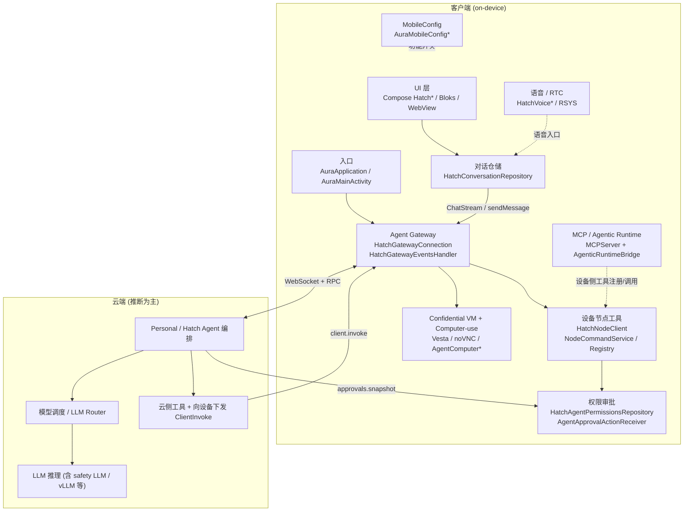
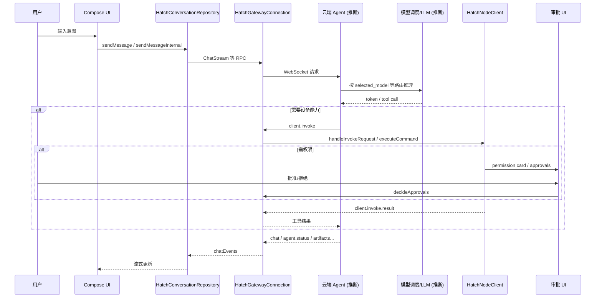
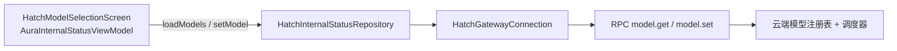

## Meta Muse（Hatch / Aura）架构设计

**分析时间:** 2026-10-10（UTC+8）  
**方法:** 静态 REA CLI + JADX（仅静态）  
**APK:** `com.facebook.aura` `11.0.0.8.164`

> 图例：**[观察]** = 类名/反编译/清单/字符串直接证据；**[推断]** = 基于命名与数据流的合理推断，未经动态验证。

---

## 1. 分层架构总览

---

## 2. 各层职责

| 层 | 代表组件 | 职责 |
|---|---|---|
| UI | `Hatch*` Compose、`AuraMainActivity`、Bloks 登录 | 会话、审批卡片、Agent Computer、内部设置（含模型选择） |
| 对话 | `HatchConversationRepository` | 发消息、流式渲染、历史、sub-agent 活动状态 |
| Gateway | `HatchGatewayConnection` / `EventsHandler` / `HatchGatewayServiceManager` | WS 连接、RPC 收发、会话订阅、事件分发 |
| 模型调度（客户端） | `RpcMethod.ModelGet/ModelSet`、`HatchInternalStatusRepository` | **查询/设置**当前模型；**不**在端上做推理路由 |
| 设备工具 | `HatchNodeClient`、`NodeCommandId`、`HatchNodeCommandRegistry` | 短信/日历/联系人/定位/闹钟等设备命令执行 |
| 审批 | `HatchAgentPermissionsRepository` | 本地+服务端审批合并、钱包选择、pending 流 |
| MCP | `com.meta.air.MCPServer`、`AgenticRuntimeBridge` | 设备侧 MCP server / native agentic runtime |
| CVM / Computer | `confidentialvm.*`、`AgentComputer*`、`assets/vmvnc` | 机密 VM、远程桌面、browser task |
| RTC | `HatchVoiceInteractionService` 等 | 系统语音助手 / 通话媒体 |

---

## 3. 主数据流（用户意图 → 结果）

**[观察]** 客户端发送走 `HatchConversationRepository.sendMessageInternal`；云端经 Gateway 回推 `chatEvents`；设备工具经 `client.invoke` → `HatchNodeClient.handleInvokeRequest`。  
**[推断]** LLM 推理与 tool planning 在云端 Agent 完成；APK 内无完整端上 LLM router。

---

## 4. 模型调度在架构中的位置

- **客户端职责 [观察]**：列举 `available_models`、读写 `selected_model` / `selectedModelId`、展示 `display_name` / `preview_model`；状态栏可显示 `HatchModelInfo`（modelName、tokens、context）。
- **云端职责 [推断]**：真正按会话/租户/`selected_model` 选择后端（含 safety LLM、experimental vLLM proxy 等字符串暗示的通道）。
- **调试字段 [观察-字符串]**：`llmModelName`、`safetyLlmEnabled`、`safetyLlmModelName`、`streamingLlmHostOverride`、`streamingLlmPortOverride`、`experimental_vllm_proxy_*`（类名仍部分混淆）。

---

## 5. 端上 vs 云端边界

| 能力 | 端上 [观察] | 云端 [推断] |
|---|---|---|
| UI / 会话缓存 | ✅ Compose、offline conversation | 权威会话与 agent 状态 |
| Gateway WS | ✅ 连接、重连、Noise/HTTP demand | Gateway 后端 / VM 路由 |
| 模型选择 RPC | ✅ ModelGet/Set 客户端 | ✅ 模型列表与生效选择 |
| LLM 推理 | ❌ 未见端上推理引擎调度器 | ✅ 主路径 |
| 设备 Node 命令 | ✅ 日历/短信/定位等执行 | 发起 invoke、消费结果 |
| 审批 | ✅ UI + 本地 pending | ✅ server approvals snapshot |
| MCP tools | ✅ JNI MCPServer / AgenticRuntime | 可能远程驱动工具 |
| Confidential VM / VNC | ✅ 客户端桥接与 PIN/Vesta | ✅ VM 供给 / vm_ws_url |
| 语音 RTC | ✅ 服务与 native RSYS | 视通话/识别后端而定 |

---

## 6. 入口点（Application / Services / Gateway）

**[观察]** Manifest：

- Application: `com.facebook.aura.app.AuraApplication`
- Gateway 前台: `HatchForegroundService`、`NodeCommandService`
- 语音: `HatchVoiceInteractionService` / `HatchRecognitionService` / `HatchAudioForegroundService`
- 审批: `AgentApprovalActionReceiver`
- 启动: `HatchBootReceiver`

`AuraApplication.onCreate` → `AuraStartupOrchestrator` + 生命周期观察者；Gateway 由 `HatchGatewayServiceManager.initialize` 等路径拉起

---

工具：https://github.com/morluto/rea

---
本人自动发布于：[https://github.com/giscafer/blog/issues/87](https://github.com/giscafer/blog/issues/87)
